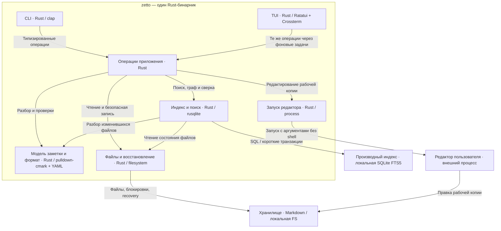

# zetto 1.0 — компоненты одного Rust-бинарника

Статус: предложение от 2026-10-29. Детализация L3; блоки внутри бинарника — модули, не отдельные процессы или пакеты. Внешние ресурсы показаны как контекст. [Полный проект](../research/2026-10-29-zetto-1.0-design.md).

Стрелки обозначают вызовы/зависимости. Производный индекс можно пересоздать; Markdown, inbox и recovery содержат пользовательские данные. CLI и TUI не зависят друг от друга.
